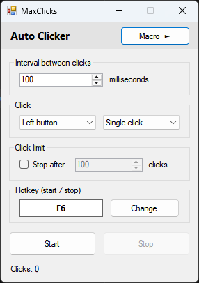

# MaxClicks

An auto clicker and macro tool for Windows, two in one, written in C# with Windows Forms.

## Features

- **Auto Clicker**
  - Left or right click, single or double, at a configurable interval (15–60000 ms; Windows timing makes values above 15 ms slightly slower than asked).
  - Click counter, with an optional limit: stop by itself after N clicks.
  - Global hotkey to start/stop from any program (default **F6**, any key or Ctrl/Alt/Shift combination).
  - The hotkey, interval, click options and click limit are remembered between runs.
- **Macro**: coming soon.
- One window, two screens: the button in the header slides between Auto Clicker and Macro.
- Window stays on top of other apps.

## Requirements

- Windows with .NET Framework 4.8 (included in Windows 10 and 11).
- To build: Visual Studio 2022 (Community is enough) with the ".NET desktop development" workload.

## Usage

1. Set the interval in milliseconds and choose the button (left / right) and single or double click. Optionally tick **Stop after** and type how many clicks.
2. Put the mouse where you want to click and press the hotkey (or click **Start**).
3. Press the hotkey again (or click **Stop**) to stop. With a click limit, it also stops by itself.

To change the hotkey, click **Change** and press the new key or combination. Esc cancels.

## Building from source

Open `AutoClicker.sln` in Visual Studio and press **F5**. The app is built as `MaxClicks.exe` in `AutoClicker\bin\Debug` (or `Release`).

## Documentation

| Doc | What it covers |
|---|---|
| [How it works](docs/HOW-IT-WORKS.md) | The code: files, screens, each feature's flow, saved settings. |
| [C# basics](docs/CSHARP-BASICS.md) | The C# and Windows Forms concepts the code uses, with a glossary. |
| [Decisions](docs/DECISIONS.md) | Why things were built this way. |
| [Testing](docs/TESTING.md) | How the app is built and tested. |
| [NOTES.md](NOTES.md) | Current state, next steps and to-do list. |
| [CLAUDE.md](CLAUDE.md) | Working guide for AI assistants (and contributors). |

## License

MIT, see [LICENSE.txt](LICENSE.txt).
